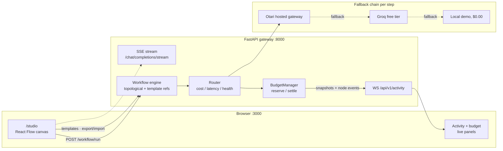

<div align="center">


# OtariOptm

**Draw the workflow. The engine picks the model. The budget holds the line.**

A visual AI workflow engine with cost-aware model routing and hard budget enforcement,
built on [Otari](https://github.com/mozilla-ai/otari) (Mozilla AI) for the DoraHacks
Devs Wilding hackathon. Every step of every run is routed, priced and accounted for
before it is spent.

[](https://github.com/gopanihitansh5-collab/otarioptm/actions/workflows/ci.yml)


[Open the studio](#-quickstart) · [API reference](docs/api.md) · [Audits](docs/audits/README.md) · [Submission checklist](docs/submission.md) · [mozilla-ai/otari](https://github.com/mozilla-ai/otari)

</div>

## 📜 What a run looks like

This is a real capture from this repository, gateway running locally. The hosted Otari
gateway answered `424` (no hosted provider configured upstream on the account), so the
chain degraded exactly as designed: to the local demo tier, at zero cost, with every
step labeled `demo`. The routing line is the router's own computation, not decoration.

```text
$ curl -s http://localhost:8000/api/v1/health
{"status":"ok","otari":true,"groq":false,
 "budget":{"cap":5.0,"spent":0.0,"reserved":0,"committed":0.0,"remaining":5.0,
           "overage":0.0,"overageCount":0}}

$ curl -s -X POST http://localhost:8000/api/v1/workflow/run \
    -H "Content-Type: application/json" \
    -d '{"nodes":[{"id":"chat","type":"chat","data":{"prompt":"Summarise the Otari gateway docs"}},
                  {"id":"polish","type":"chat","data":{"prompt":"Rewrite {{chat}} as two bullets"}}],
         "edges":[{"source":"chat","target":"polish"}]}'
{"results":[{
  "nodeId": "chat",
  "model": "demo",
  "chain": ["otari->demo"],
  "tokens": 68, "cost": 0.0, "latencyMs": 199,
  "routing": "gpt-4o-mini: cost=1.500e-07/token (est $0.000075/call), latency=600ms,
              health=0.95 -> fitness=+0.845 | est_call=$0.000075 <= budget=$5.000000",
  "demo": true,
  "note": "otari error 424 (HTTPException)",
  "overBudget": false
}]}

$ curl -s http://localhost:8000/api/v1/budget
{"cap":5.0,"spent":0.0,"reserved":0,"committed":0.0,"remaining":5.0}

$ curl -N -X POST http://localhost:8000/api/v1/chat/completions/stream ...
event: delta
data: {"delta": "[demo mode | node adhoc-"}
```

Set `OTARI_API_KEY` or `GROQ_API_KEY` and the same graph executes on live models with
real usage-based costs; nothing else changes. The fallback chain is visible on every
step (`chain`), the reason the router picked a candidate is on every step (`routing`),
and the money is on every step (`cost`).

## 🚀 Quickstart

No API keys, wallet or GPU needed. Under two minutes, end to end.

```bash
git clone https://github.com/gopanihitansh5-collab/otarioptm.git && cd otarioptm
pip install -r requirements.txt
python run_server.py                                # gateway on http://localhost:8000

cd web && npm install && npm run dev                # web on http://localhost:3000
```

- `http://localhost:3000` : landing page
- `http://localhost:3000/studio` : the workflow editor. Add nodes, wire them, press Run.

One command for the whole stack:

```bash
docker compose up --build       # gateway on :8000, web on :3000 (Compose v2.24+)
```

Keys are optional and read from the environment only (`OTARI_API_KEY`, `GROQ_API_KEY`,
`EXA_API_KEY`, `RESEND_API_KEY`); they are never committed and never baked into images.

## ✅ Why it exists

AI workloads leak money in three quiet ways, and every existing gateway treats them as
someone else's problem:

- **Model choice is a guess.** Builders hardcode one model per step and never see the
  price of that habit. OtariOptm scores every candidate per step from cost, latency and
  health, and returns the winning score line with the result.
- **Spend is discovered after the invoice.** Caps that check *after* the call still paid
  for the call. The BudgetManager reserves estimated cost *before* execution and
  answers HTTP 402 at the cap, so an over-budget run never starts.
- **Routing is invisible.** When a gateway silently picks a model, you cannot audit it.
  Here the routing decision is a first-class output on every step, in the API, the
  studio and the live activity feed.
- **Demos die without keys.** Judges and new users should not need accounts. With no
  usable upstream the same engine, router and budget run locally at $0.00 with every
  synthetic step labeled `demo`.

## 🏗️ Architecture



The engine is a topological executor (Kahn's algorithm, cycles rejected with HTTP 400):
each node's output feeds downstream nodes through template references. The router scores
candidates per step type, the budget manager reserves before it settles, and the chain
degrades Otari to Groq to local demo. Full detail:
[docs/architecture.md](docs/architecture.md).

## 🧭 How routing decides

`src/services/router.py` scores every candidate for the step type. Higher fitness wins:

```text
fitness = cost_w * (1 - cost_norm)
        + lat_w  * (1 - latency_norm)
        + health_w * 0.5 * (health - 0.5)
```

`cost_norm` and `latency_norm` are 0 for the best and 1 for the worst candidate, so
cheap and fast raise the score; health is a **reward**, so a healthy model raises it too.
The health weight is derived from the step type, so a step that must be correct pays
more for health than a step that must be cheap:

| Step type | cost_w | latency_w | health_w | Rationale |
|---|---|---|---|---|
| chat (default) | 0.45 | 0.35 | 0.20 | cost first, latency second |
| code | 0.30 | 0.25 | 0.45 | health dominates: wrong answers are expensive |
| search | 0.40 | 0.45 | 0.15 | freshness beats pennies |

Selection is budget-aware: the estimated cost of one call (`per-token cost x token
estimate`, the model's own `max_tokens` hint wins, default 500 tokens) is compared with
the remaining budget, and a zero-cost tier wins whenever no paid model fits. The same
estimate is used by the budget reservation, so the router never picks a model that
reserve then rejects. Health comes from the catalog stamped by a background probe with
a 60s TTL (`health_probe.source`: `catalog` live, `synthetic-demo` in demo mode).

## 🧰 Features

| Feature | What it does |
|---|---|
| Visual studio | React Flow canvas: Model Chat, Web Search, Code Exec, Guardrails nodes |
| Templates gallery | 4 starter graphs (research, guarded chat, code review, fact check), one click to canvas, one click to run |
| Workflow execution | Topological ordering, template references, per-node outputs, cycles rejected |
| Auto model routing | Per-step-type fitness scoring, budget-aware selection, score line on every step |
| Budget enforcement | Reserve before spend, settle exactly once, HTTP 402 pre-spend block at the cap (default $5.00) |
| 402 overdraft demo | A labeled client-side demo cap that shows the blocked path without touching the real cap |
| Per-node cost badges | Real cost on every executed node, red for blocked or failed |
| Streaming | SSE `POST /chat/completions/stream` with named events, heartbeats and honest error events |
| Live activity | WebSocket feed of budget snapshots and node events, pings filtered out |
| CSV export | Full activity log with a TOTAL row via `GET /api/v1/export` |
| Run history | Past runs with cost, tokens and duration, persisted locally, honest `blocked` status |
| Export / import | Workflow JSON download and validated import |
| Persistence + undo | localStorage graph with a validated snapshot and a v1 to v2 migration, undo/redo, Ctrl+Z/Y, Ctrl+S, Delete, `?` shortcut dialog |
| Mobile editing | Palette and inspector become drawers below 768px, focus trapped, keyboard reachable |
| Zero-key demo mode | Full stack runs at $0.00 with no usable upstream; every step labeled `demo` |
| Rate limiting | Per-IP token bucket on mutating endpoints, HTTP 429 + Retry-After, `/health` exempt |
| Input limits | Nodes, edges, prompts, code and `max_tokens` are capped with HTTP 400, never a 500 |

## 🔌 API

Full request/response reference with examples: [docs/api.md](docs/api.md).

| Method | Path | Purpose |
|---|---|---|
| GET | `/api/v1/health` | Gateway health check |
| GET | `/api/v1/budget` | Current budget state |
| GET | `/api/v1/models` | Model catalog with cost, latency, health and probe stamps |
| POST | `/api/v1/chat/completions` | Single chat completion through the fallback chain |
| POST | `/api/v1/chat/completions/stream` | Same completion as an SSE token stream |
| POST | `/api/v1/workflow/run` | Execute a workflow graph (`{nodes, edges}`) |
| GET | `/api/v1/templates` | Starter workflow templates |
| GET | `/api/v1/templates/{id}` | One template's full `{nodes, edges}` graph |
| GET | `/api/v1/export` | Activity log as CSV (with TOTAL row) |
| GET | `/api/v1/activity` | Activity log snapshot |
| WS | `/api/v1/activity` | Live budget snapshots + node events (ping/pong) |

## 🧪 Tests and verification

Measured on this machine, 2026-11-11 (Python 3.14, Node 22.14, Windows 11). CI runs the
same gates on every push to `main`, with zero secrets.

| Gate | Result | Reproduce |
|---|---|---|
| Backend suite | 87 passed | `python -m pytest tests -q` |
| Web typecheck | clean | `cd web && npx tsc --noEmit` |
| Web lint | 0 problems | `cd web && npm run lint` |
| Web build | all routes static | `cd web && npm run build` |
| Boot smoke | health 200, templates 200 | `python run_server.py`, then curl the endpoints |
| Config truth | config matches code defaults | CI step comparing `config/config.yml` to `DEFAULT_CONFIG` |

Three independent audits (backend, frontend, integration) were run against this
codebase and their findings fixed in the same session. The reports are published, not
hidden: [docs/audits/README.md](docs/audits/README.md). Among them: an escapable code
exec sandbox, a budget that could double count on the provider error path, unbounded
inputs, a health signal that was mis-scaled and sign-flipped (which made the routing
claim false), a CORS pattern that blocked every deploy, and a live counter that froze
on the landing page.

## 🚀 Deployment (Vercel services)

`vercel.json` deploys both halves as one project with two services:

| Service | Root | Framework | Public on |
|---|---|---|---|
| `app` | `.` (entrypoint `api/index.py`) | FastAPI | `/api/(.*)` |
| `web` | `web` | Next.js 16 | everything else |

The web service declares a binding to the app service
(`{"type":"service","service":"app","format":"url","env":"GATEWAY_INTERNAL_URL"}`), and
the browser calls the gateway through same-origin `/api/v1/...` paths, so no absolute
gateway URL is needed at build time. Set the provider keys in the Vercel project
(`OTARI_API_KEY`, `GROQ_API_KEY`, `EXA_API_KEY`, `RESEND_API_KEY`), plus
`ALLOWED_ORIGINS` for extra CORS origins. `vercel dev` runs both services locally.
Details: [docs/quickstart.md](docs/quickstart.md#deploy-on-vercel).

## ⚖️ Design decisions

| Why this | Over that | Reason |
|---|---|---|
| Reserve *before* execution | Check the cap after the call | A post-hoc cap still paid for the call; reserve and settle under one lock mean an over-budget run never starts |
| Settle exactly once | Record, then release | A released reservation can be re-claimed while the spend is recorded: the cap can be overshot |
| Fallback chain per step | Single provider | A dead provider is a routing event, not an outage; the chain reports what it did on every step |
| Visual canvas | YAML or JSON config workflows | Routing and budget are easier to trust when the graph itself is on screen |
| Score line on every step | Silent gateway-side routing | Unauditable routing is a trust problem, not a feature |
| Demo mode with synthetic labels | Require keys to run | Minute-to-demo beats a locked repo; every synthetic value is labeled `demo` |
| localStorage over a database | Postgres persistence | Single-user MVP; the graph schema is JSON and portable (export and import) |
| AST validation for code exec | A sandbox boundary claim | The exec node is in-process and MVP-grade; the AST check closes the known escape classes and the docs say what it is |

## 🗂️ Project tree

```text
src/gateway/main.py       FastAPI app: routes, SSE, WS, rate limiting, create_app() factory
src/services/router.py    fitness scoring per step type, budget-aware selection
src/services/budget.py    BudgetManager: reserve, settle, release, cap enforcement
src/services/otari_client.py  Otari hosted gateway client
src/services/search.py    web search client (Exa + fallback)
config/config.yml         live config (budget cap, rate limit) + config/example.yml
tests/                    pytest suite: API, budget, router, gateway features (87 tests)
web/src/app/              landing, /studio, /privacy, /terms, OG image, icon
web/src/components/       landing sections, React Flow canvas, nodes, studio panels
web/src/lib/              api client, workflow validation, snapshots, templates
docs/                     api, architecture, quickstart, submission, status, audits/
api/index.py              Vercel entrypoint for the gateway service
.opencode/                agent kit: 8 agents, 2 skills, 1 command (see AGENTS.md)
vercel.json               multi-service deployment (app + web)
```

## 🧱 Stack

| Layer | Technology |
|---|---|
| Backend | Python, FastAPI, uvicorn, pytest |
| Workflow engine | Topological execution (Kahn), template references, cycle detection |
| Routing | Fitness scoring per step type, TTL health probes, budget-aware selection |
| Budget | Reserve and settle under a lock, HTTP 402 pre-spend block |
| Frontend | Next.js 16 (App Router), React 19, Tailwind CSS v4 |
| Studio | React Flow (`@xyflow/react`), R3F hero scene |
| Live | WebSocket + SSE, CSV export |
| Delivery | GitHub Actions (backend, web, summary), Docker, Vercel services |

## 👥 Agent kit

The repository ships its own operating kit under `.opencode/`: eight specialist agents
(`backend`, `frontend`, `qa`, `docs`, `security-reviewer`, `architect`, `explore`,
`orchestrator`), two skills (`parallel-engineering`, `otarioptm-context`) and a
`/parallel` command. [AGENTS.md](AGENTS.md) is the operating contract:
[docs/TEAM-KIT-INSTALL.md](docs/TEAM-KIT-INSTALL.md).

## 📚 Documentation

[API reference](docs/api.md) · [Architecture](docs/architecture.md) · [Quickstart](docs/quickstart.md) · [Features](docs/features.md) · [Status](docs/STATUS.md) · [Submission](docs/submission.md) · [Audits](docs/audits/README.md) · [Design system](MASTER.md)

## Honest limits

- **Demo mode is synthetic.** With no usable upstream, chat output is deterministic
  local text labeled `demo` at $0.00. It proves the engine path, not model quality.
- **The routing line names the chosen candidate.** When the chain falls back, the
  `chain` field discloses the provider that actually served the request.
- **Code Exec is MVP-grade.** The sandbox is in-process with AST validation, a blocked
  import list and a 5s timeout. It is not a security boundary.
- **Budget state is single-process.** The reserve and settle lock holds within one
  gateway process; horizontal scaling needs a shared store.
- **Latency figures are catalog values.** The probe stamps health; per-model latency
  comes from the catalog, not measured percentiles.
- **WebSockets may not connect on Vercel.** Vercel's Python runtime does not upgrade
  WebSocket connections, so on a Vercel deploy the live activity socket may fall back
  to the studio's honest offline card. The REST API and SSE still work.
- **No auth or multi-tenancy.** One project, one budget cap, per-IP rate limiting only.

Built for the DoraHacks Devs Wilding Online! hackathon (Mozilla Otari).
[Apache 2.0](LICENSE).
